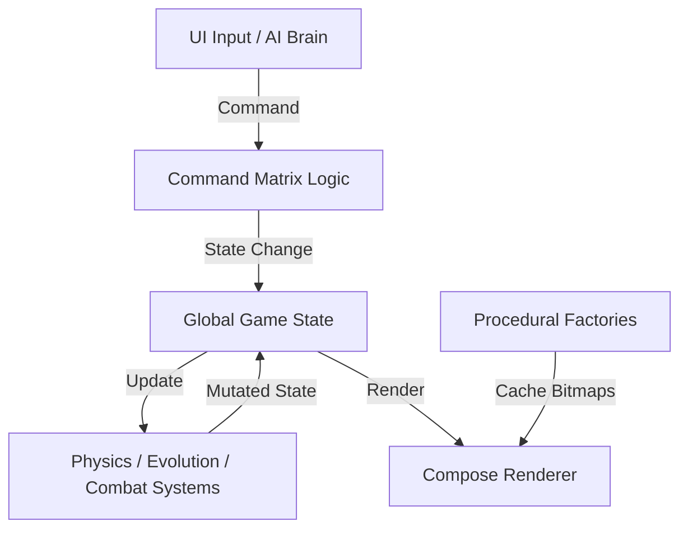

# Seeds of Sovereignty - System Architecture

## 1. High-Level Topology
The project follows a **Modified Model-View-Intent (MVI)** with a **Stateless Logic Pipeline**.

## 2. Package Responsibilities
To prevent "God Scripts", each package has a strict boundary:

### `com.seedsofsovereignty.core`
*   **Constants**: Resolution (1280x720), Tier scales (1-12), HudStyles.
*   **Math**: `Vector2D`, `GeometryUtils`, `Projection3D`.
*   **Protocols**: Interfaces for `Module`, `Generator`, `System`.

### `com.seedsofsovereignty.model`
*   **State Containers**: `ShipState`, `ModuleState`, `WorldState`.
*   **Data Only**: No logic, no Android imports. Pure Kotlin data classes.

### `com.seedsofsovereignty.factory` (The Procedural Engine)
*   **Assets**: `StarfieldFactory`, `ShipPartFactory`, `HudElementFactory`.
*   **Logic**: Drawing paths to `ImageBitmap` once, then caching.
*   **Outputs**: Diffuse (Color), Normal (Fake-3D), Emissive (Lights).

### `com.seedsofsovereignty.logic` (The Systems)
*   **Physics**: Newtonian inertia, rotational drag.
*   **Command Matrix**: Translating UI/AI inputs to module activations.
*   **Evolution**: Logic for Tier progression and chassis resizing.

### `com.seedsofsovereignty.render` (The View)
*   **Canvas Layers**: Drawing the world state using the cached bitmaps.
*   **Shaders**: Applying normal-mapped lighting and bloom effects.

## 3. Communication Protocols
*   **Downstream (Logic -> State)**: Systems modify the `GameState` object.
*   **Upstream (State -> Render)**: The Compose `Canvas` observes the `GameState` and draws the current frame.
*   **Horizontal (Module -> Matrix)**: Modules report their `ControlType` to the Matrix, which then builds the appropriate UI/AI hooks.
